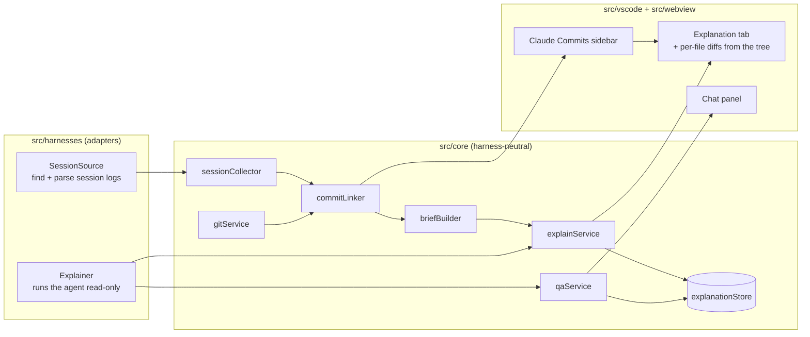

# Architecture

Explain Diff has three layers. Only the adapters in `src/harnesses/` know anything about a specific agent.

## Flow for one commit

1. **Collect.** Every enabled `SessionSource` lists its session files for the open folder, and `collectSessions` parses them into generic `Session`s. Results are cached by file modification time.
2. **Link.** `commitLinker` finds commits in each session. It matches `[branch sha]` lines in the results of `shellCommand`s that ran `git commit`, then quiet commits by timing, then commits carrying a source's `commitTrailer` within the session's time window.
3. **Brief.** `briefBuilder` turns the session into a token-budgeted summary. The conversation around the commit is kept in full.
4. **Explain.** `explainService` sends the brief, `git show --stat` and the diff to the configured `Explainer`. The reply must be JSON that matches `explanationSchema`; it gets one repair round, then is cached per commit.
5. **Show.** The explanation tab renders pure HTML from `src/webview/render.ts`, then Mermaid draws the diagrams in the webview. Expanding a commit in the sidebar lists its changed files; clicking one opens its diff in a preview tab.
6. **Chat.** `qaService` resumes the explainer's session (`explainerSessionId`), or falls back to a fresh run that carries the explanation and history. Threads are stored with the explanation.

## Key rules

- **Read-only.** Nothing writes to the user's repository. Explainers must keep the model read-only.
- **Escape everything.** Model output is untrusted. `render.ts` escapes all text before it becomes HTML, and webviews run under a strict CSP with mermaid `securityLevel: 'strict'`.
- **One failure stays local.** A broken session file, source or diagram never breaks the rest of the view.
