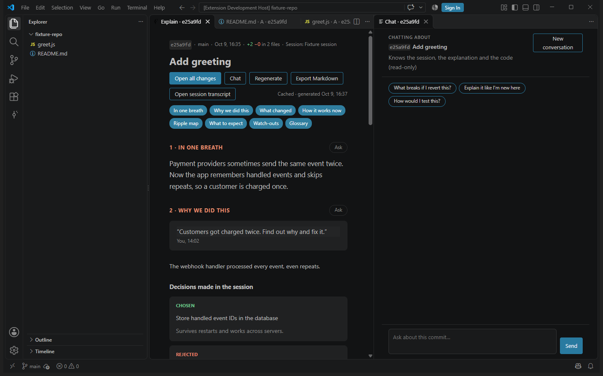

# Explain Diff

**Understand every commit your coding agent made, in plain language, with diagrams, and with the conversation that led to it.**

Explain Diff is a VS Code and Cursor extension. It lists the commits an AI coding agent made in your repository, grouped by the agent session that made them. Click one to get a "360°" explanation:

1. **In one breath:** a 2–3 sentence summary
2. **Why we did this:** your original request (quoted from the session), the decisions made and the alternatives rejected, plus a session timeline
3. **What changed:** grouped by purpose, before and after, with links to the files
4. **How it works now:** a flow or sequence diagram
5. **Ripple map:** who else in the app uses the changed code, verified by actually searching the repo
6. **What to expect:** behaviour changes and how to check them yourself
7. **Watch-outs:** risks, edge cases and follow-ups
8. **Glossary:** every technical term in simple words

The explanation opens in a tab, and the commit expands in the sidebar to list its changed files: click one to see its diff. A **chat panel** beside it lets you ask follow-up questions, and the history is kept per commit. Diagrams can be maximized with zoom and pan.

## Supported harnesses

| Harness | Sessions | Explainer |
|---|---|---|
| Claude Code | ✅ | ✅ (default) |
| Your favourite agent | [add it!](CONTRIBUTING.md#adding-a-new-harness) | |

## Install

Explain Diff is not on the Marketplace yet. Build or download a `.vsix`:

- **From CI:** download `explain-diff-vsix` from the latest successful run on the [Actions tab](https://github.com/csumudu/explain-diff/actions).
- **From source:** `corepack enable && pnpm install && pnpm run package`.

Then install it:
- **VS Code:** open the Extensions view, click **…**, choose **Install from VSIX…** and pick the file.
- **Cursor:** right-click the `.vsix` in the Explorer and choose **Install Extension VSIX**, or use the Command Palette: **Extensions: Install from VSIX…**.

Reload the window after installing or updating.

**Requirements:** VS Code 1.90+ or Cursor, Git, and for explanations the Claude Code CLI installed and signed in (`claude --version` works).

## Use

1. Open a repository where you have used a supported agent.
2. Open the **Claude Commits** view in the activity bar.
3. Click a commit. The explanation opens with the chat beside it, and the commit expands to list its changed files. Click a file to open its diff.
4. Use **Ask** on any section to ask about it, **⤢** on a diagram to maximize it, and **Export Markdown** to save the explanation together with the conversation.

## Settings

| Setting | Default | Meaning |
|---|---|---|
| `explainDiff.sessionSources` | `["claude-code"]` | Which harnesses to read sessions from |
| `explainDiff.explainer` | `claude-code` | Which agent writes explanations and chat answers |
| `explainDiff.claudePath` | `claude` | Path to the Claude Code CLI |
| `explainDiff.model` | (CLI default) | Model passed to the explainer |
| `explainDiff.timeoutSeconds` | `180` | Time limit for one explanation or answer |
| `explainDiff.briefTokenBudget` | `30000` | Size of the session context sent to the explainer |

## Privacy

Session logs are read locally. Explanations run through your own agent CLI with a restricted tool list: file reading and search plus `git show`, `git log` and `git grep`, with edit and write tools disabled and no MCP servers. Explain Diff never asks the agent to change your repository, and nothing is sent anywhere except to the agent you configured. The tool list is an allow-list, not a sandbox; see [SECURITY.md](SECURITY.md). Explanations and chats are cached in VS Code's extension storage on your machine.

## Contributing

Contributions are welcome, especially support for more agent harnesses. Start with [CONTRIBUTING.md](CONTRIBUTING.md) and [ARCHITECTURE.md](ARCHITECTURE.md).

## License

[MIT](LICENSE)
