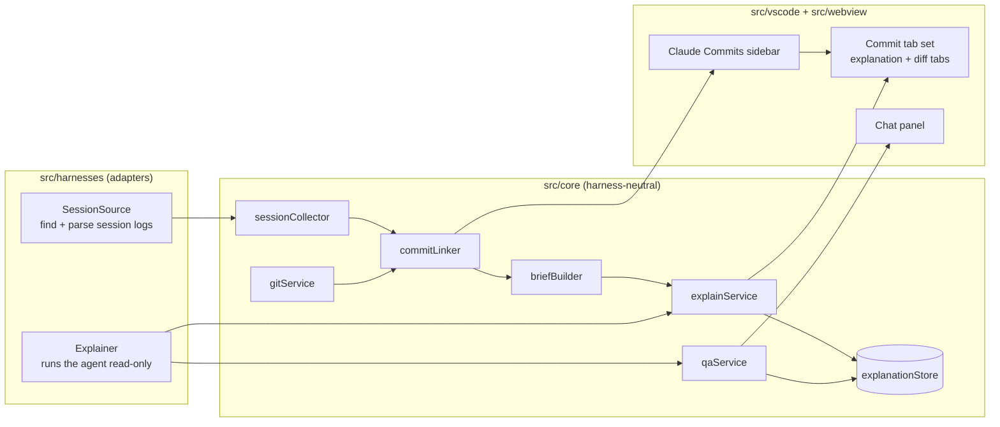

# Harness Adapters and Open-Source Publishing Implementation Plan

> **For agentic workers:** REQUIRED SUB-SKILL: Use superpowers:subagent-driven-development (recommended) or superpowers:executing-plans to implement this plan task-by-task. Steps use checkbox (`- [ ]`) syntax for tracking.

**Goal:** Split Claude Code out of the core behind `SessionSource` and `Explainer` interfaces with a reusable contract test suite, then publish the project as the public GitHub repo `csumudu/explain-diff` with contributor documentation.

**Architecture:** Harness-specific code moves to `src/harnesses/<id>/`. The core works only with the generic `Session` model, which gains `sourceId` plus the normalised `shellCommand`/`editedFile` fields on tool calls. `src/harnesses/registry.ts` maps ids to factories. The extension reads every enabled source and uses one configured explainer. A shared contract suite in `test/harnesses/contract/` is the acceptance gate for new sources.

**Tech Stack:** TypeScript 5, VS Code API ^1.90, pnpm 12 (via corepack), vitest, esbuild, GitHub Actions, gh CLI.

**Spec:** `docs/superpowers/specs/2026-10-09-harness-adapters-design.md` (builds on `docs/superpowers/specs/2026-10-09-explain-diff-design.md`)

## Global Constraints

- Run every command through `corepack pnpm …`, because the global `pnpm` shim on this machine is broken.
- Source ids are stable kebab-case; the built-in id is `claude-code`, display name `Claude Code`.
- New settings `explainDiff.sessionSources` (default `["claude-code"]`) and `explainDiff.explainer` (default `"claude-code"`), both `scope: "machine"`.
- Explainers stay read-only: the model may read the repository but must never write files or run arbitrary commands.
- Caches written before this change, which use `claudeSessionId`, must keep working.
- `EXPLAIN_DIFF_PROJECTS_DIR` remains the Claude Code source's test override.
- The public repo is `csumudu/explain-diff`, public, MIT (© 2026 Sumudu Jayasinghe), published as one commit "Initial public release" on `main`. Local branches stay untouched.
- The README screenshot comes from the smoke-test fixture, never from a real project.

## Review Focus

1. **Unknown source id in settings** (a typo, or a harness removed in an update) → it is skipped, the others still load, and nothing throws. Pinned in Task 4 (`createSources` test).
2. **Unknown explainer id** → falls back to `claude-code` instead of crashing activation. Pinned in Task 4 (`createExplainer` test).
3. **One source failing** (its folder is unreadable, `findSessionFiles` throws, or a file fails to parse) → that source's sessions are skipped and the other sources still list theirs. Pinned in Task 5 (`collectSessions` test).
4. **The same session file returned twice** (two workspace paths, or two sources pointing at one folder) → listed once. Pinned in Task 5 (`collectSessions` test).
5. **A cached explanation from before the rename** (`claudeSessionId`) → chat still resumes that Claude session. Pinned in Task 3 (store legacy test).

---

## File Structure

```
src/harnesses/types.ts                     SessionSource, Explainer, RunOptions/RunResult/RunProgress, option types
src/harnesses/errors.ts                    ExplainerNotFoundError, ExplainerTimeoutError, ExplainerAbortedError, ExplainerRunError
src/harnesses/registry.ts                  SESSION_SOURCES, EXPLAINERS, createSources(), createExplainer()
src/harnesses/claude-code/explainer.ts     (moved from src/core/claudeRunner.ts) ClaudeRunner + createClaudeCodeExplainer
src/harnesses/claude-code/transcript.ts    (moved from src/core/transcriptParser.ts)
src/harnesses/claude-code/locate.ts        (moved from src/core/sessionLocator.ts)
src/harnesses/claude-code/source.ts        createClaudeCodeSource, CLAUDE_TRAILER
src/harnesses/claude-code/README.md        format notes
src/core/sessionCollector.ts               collectSessions(): all sources → sessions (dedupe, failure isolation, mtime cache)
test/harnesses/contract/sessionSource.contract.ts   reusable contract suite
test/harnesses/claude-code/*.test.ts       explainer, transcript, locate, source (contract) tests
test/harnesses/registry.test.ts
test/fixtures/harnesses/claude-code/       fixture projects dir + expectations.json
LICENSE, README.md, CONTRIBUTING.md, ARCHITECTURE.md, CODE_OF_CONDUCT.md, SECURITY.md
.github/ISSUE_TEMPLATE/{bug_report.yml,new_harness.yml,config.yml}, .github/pull_request_template.md, .github/workflows/ci.yml
docs/media/screenshot.png
```

---

### Task 1: Harness types, neutral errors, Claude Code explainer

**Files:**
- Create: `src/harnesses/types.ts`, `src/harnesses/errors.ts`
- Move: `src/core/claudeRunner.ts` → `src/harnesses/claude-code/explainer.ts`; `test/unit/claudeRunner.test.ts` → `test/harnesses/claude-code/explainer.test.ts`
- Modify: `vitest.config.ts`, `tsconfig.json`, `src/core/explainService.ts`, `src/core/qaService.ts`, `src/vscode/explainPanel.ts`, `src/vscode/chatPanel.ts`, `src/vscode/extension.ts`

**Interfaces:**
- Produces:
  - from `src/harnesses/types.ts`: `RunProgress`, `RunOptions`, `RunResult` (unchanged shapes), `SourceOptions`, `ExplainerOptions`, `SessionSource`, `Explainer`
  - from `src/harnesses/errors.ts`: the four error classes. `ExplainerRunError` has `exitCode: number | null` and `stderrTail: string`.
  - from `src/harnesses/claude-code/explainer.ts`: `ClaudeRunner` (same constructor), `buildArgs`, `buildSpawn`, `ALLOWED_TOOLS`, `DISALLOWED_TOOLS`, and `createClaudeCodeExplainer(o: ExplainerOptions): Explainer`

- [ ] **Step 1: Move files and widen the test globs**

```bash
mkdir -p src/harnesses/claude-code test/harnesses/claude-code
git mv src/core/claudeRunner.ts src/harnesses/claude-code/explainer.ts
git mv test/unit/claudeRunner.test.ts test/harnesses/claude-code/explainer.test.ts
```

`vitest.config.ts`: change `include: ['test/unit/**/*.test.ts']` to `include: ['test/unit/**/*.test.ts', 'test/harnesses/**/*.test.ts']`.
`tsconfig.json`: change `"include": ["src", "test/unit"]` to `"include": ["src", "test/unit", "test/harnesses"]`.

- [ ] **Step 2: Write the failing test.** Fix the moved test's paths and names, then add the explainer metadata test.

In `test/harnesses/claude-code/explainer.test.ts`:
- Replace `'../fake-claude/fake-claude.mjs'` with `'../../fake-claude/fake-claude.mjs'`.
- Replace `'../../src/core/claudeRunner'` with `'../../../src/harnesses/claude-code/explainer'`.
- Rename the errors: `ClaudeNotFoundError` → `ExplainerNotFoundError`, `ClaudeRunError` → `ExplainerRunError`, `ClaudeTimeoutError` → `ExplainerTimeoutError`, `ClaudeAbortedError` → `ExplainerAbortedError`.
- The errors now import from `'../../../src/harnesses/errors'`. `RunProgress` imports from `'../../../src/harnesses/types'`.

The import block becomes:

```ts
import { ClaudeRunner, buildArgs, buildSpawn, ALLOWED_TOOLS, createClaudeCodeExplainer } from '../../../src/harnesses/claude-code/explainer';
import { ExplainerNotFoundError, ExplainerRunError, ExplainerTimeoutError, ExplainerAbortedError } from '../../../src/harnesses/errors';
import type { RunProgress } from '../../../src/harnesses/types';
```

Append:

```ts
describe('createClaudeCodeExplainer', () => {
  it('describes itself and points setup at the claudePath setting', () => {
    const e = createClaudeCodeExplainer({ settings: () => undefined });
    expect(e.id).toBe('claude-code');
    expect(e.displayName).toBe('Claude Code');
    expect(e.setup.settingId).toBe('explainDiff.claudePath');
    expect(e.setup.docsUrl).toMatch(/^https:\/\//);
  });
  it('reads claudePath from settings', async () => {
    const e = createClaudeCodeExplainer({ settings: (k) => (k === 'claudePath' ? join(tmpdir(), 'no-such-claude-binary') : undefined) });
    expect(await e.version()).toBeNull();
  });
});
```

- [ ] **Step 3: Run the test and confirm it fails**

Run: `npx vitest run test/harnesses/claude-code/explainer.test.ts`
Expected: FAIL. `../../../src/harnesses/errors` can't be found, or the `createClaudeCodeExplainer` export is missing.

- [ ] **Step 4: Create** `src/harnesses/types.ts`

```ts
import type { Session } from '../core/types';

export type RunProgress = { type: 'tool'; name: string; detail: string } | { type: 'text'; text: string };

export interface RunOptions {
  cwd: string;
  prompt: string;
  resumeSessionId?: string;
  timeoutMs: number;
  model?: string;
  maxTurns?: number;
  signal?: AbortSignal;
  onProgress?: (p: RunProgress) => void;
}

export interface RunResult {
  text: string;
  sessionId: string;
}

export interface SourceOptions {
  homeDir: string;
  env: NodeJS.ProcessEnv;
}

export interface ExplainerOptions {
  /** Reads `explainDiff.<key>`. */
  settings: (key: string) => unknown;
}

/** Where agent sessions come from. One per harness. */
export interface SessionSource {
  /** Stable kebab-case id, e.g. 'claude-code'. */
  id: string;
  /** Human name, e.g. 'Claude Code'. */
  displayName: string;
  /** Session log files recorded for any of these folders. Must resolve to [] when nothing is found. */
  findSessionFiles(workspacePaths: string[], platform?: NodeJS.Platform): Promise<string[]>;
  /** Parses one log into the generic Session model. Must skip malformed lines instead of throwing. */
  parseSession(file: string): Promise<Session>;
  /** Trailer this harness adds to the commits it makes, if any. */
  commitTrailer?: RegExp;
}

/** Writes explanations and chat answers. Must keep the model read-only. */
export interface Explainer {
  id: string;
  displayName: string;
  run(o: RunOptions): Promise<RunResult>;
  version(): Promise<string | null>;
  /** Shown when the tool is missing. */
  setup: { message: string; docsUrl: string; settingId: string };
}
```

`src/harnesses/errors.ts`:

```ts
export class ExplainerNotFoundError extends Error {}
export class ExplainerTimeoutError extends Error {}
export class ExplainerAbortedError extends Error {}
export class ExplainerRunError extends Error {
  constructor(message: string, readonly exitCode: number | null, readonly stderrTail: string) {
    super(message);
  }
}
```

- [ ] **Step 5: Edit** `src/harnesses/claude-code/explainer.ts`
  - Delete its local `RunProgress`, `RunOptions` and `RunResult` declarations and the four `Claude*Error` class declarations.
  - Add these imports at the top:

```ts
import { ExplainerAbortedError, ExplainerNotFoundError, ExplainerRunError, ExplainerTimeoutError } from '../errors';
import type { Explainer, ExplainerOptions, RunOptions, RunResult } from '../types';
```

  - Replace every remaining use: `ClaudeNotFoundError` → `ExplainerNotFoundError`, `ClaudeTimeoutError` → `ExplainerTimeoutError`, `ClaudeAbortedError` → `ExplainerAbortedError`, `ClaudeRunError` → `ExplainerRunError`.
  - Append:

```ts
export function createClaudeCodeExplainer(o: ExplainerOptions): Explainer {
  const runner = () => new ClaudeRunner(String(o.settings('claudePath') || 'claude'));
  return {
    id: 'claude-code',
    displayName: 'Claude Code',
    run: (opts) => runner().run(opts),
    version: () => runner().version(),
    setup: {
      message: 'Explanations need the Claude Code CLI installed and signed in.',
      docsUrl: 'https://docs.claude.com/en/docs/claude-code/overview',
      settingId: 'explainDiff.claudePath',
    },
  };
}
```


- [ ] **Step 6: Update the consumers**

```bash
python - <<'EOF'
import re, pathlib
ren = {'ClaudeNotFoundError':'ExplainerNotFoundError','ClaudeTimeoutError':'ExplainerTimeoutError','ClaudeAbortedError':'ExplainerAbortedError','ClaudeRunError':'ExplainerRunError'}
for p in ['src/core/explainService.ts','src/core/qaService.ts','src/vscode/explainPanel.ts','src/vscode/chatPanel.ts','test/unit/qaService.test.ts','test/unit/explainService.test.ts']:
    s = pathlib.Path(p).read_text(encoding='utf-8')
    for a,b in ren.items(): s = s.replace(a,b)
    pathlib.Path(p).write_text(s, encoding='utf-8', newline='\n')
EOF
```

Then fix the imports by hand:
- **`src/core/explainService.ts`:** `import type { ClaudeRunner, RunProgress } from './claudeRunner';` becomes `import type { Explainer, RunProgress } from '../harnesses/types';`. `runner: Pick<ClaudeRunner, 'run'>;` becomes `runner: Pick<Explainer, 'run'>;`.
- **`src/core/qaService.ts`:** the first import becomes two imports: `import { ExplainerRunError } from '../harnesses/errors';` and `import type { Explainer, RunProgress, RunResult } from '../harnesses/types';`. `runner: Pick<ClaudeRunner, 'run'>;` becomes `runner: Pick<Explainer, 'run'>;`.
- **`src/vscode/explainPanel.ts`:** the import becomes `import { ExplainerAbortedError, ExplainerNotFoundError, ExplainerRunError, ExplainerTimeoutError } from '../harnesses/errors';`.
- **`src/vscode/chatPanel.ts`:** the import becomes `import { ExplainerAbortedError } from '../harnesses/errors';`.
- **`test/unit/qaService.test.ts`:** the error import becomes `import { ExplainerRunError, ExplainerTimeoutError } from '../../src/harnesses/errors';` and `import type { RunOptions } from '../../src/harnesses/types';`.
- **`test/unit/explainService.test.ts`:** `import type { RunOptions, RunResult } from '../../src/core/claudeRunner';` becomes `'../../src/harnesses/types'`.
- **`src/vscode/extension.ts`:**
  - `import { ClaudeRunner } from '../core/claudeRunner';` becomes `import { createClaudeCodeExplainer } from '../harnesses/claude-code/explainer';`.
  - `const runner = () => new ClaudeRunner(config().claudePath);` becomes `const explainer = createClaudeCodeExplainer({ settings: (k) => vscode.workspace.getConfiguration('explainDiff').get(k) });`.
  - Each `{ run: (o) => runner().run(o) }` becomes `explainer`.
  - `runner().version()` becomes `explainer.version()`.

- [ ] **Step 7: Run all tests and the typecheck**

Run: `corepack pnpm typecheck && corepack pnpm test`
Expected: typecheck clean, all tests pass (117 plus 2 new).

- [ ] **Step 8: Commit**

```bash
git add -A
git commit -m "refactor: Explainer interface with Claude Code as the first explainer"
```

---

### Task 2: Neutral session model and the Claude Code session source

**Files:**
- Modify: `src/core/types.ts`, `src/core/commitLinker.ts`, `src/core/briefBuilder.ts`
- Move: `src/core/transcriptParser.ts` → `src/harnesses/claude-code/transcript.ts`, `src/core/sessionLocator.ts` → `src/harnesses/claude-code/locate.ts`, `test/unit/transcriptParser.test.ts` → `test/harnesses/claude-code/transcript.test.ts`, `test/unit/sessionLocator.test.ts` → `test/harnesses/claude-code/locate.test.ts`
- Create: `src/harnesses/claude-code/source.ts`
- Test: `test/harnesses/claude-code/transcript.test.ts`, `test/unit/commitLinker.test.ts`

**Interfaces:**
- Consumes: `SessionSource`, `SourceOptions` (Task 1).
- Produces:
  - `SessionEvent` toolCall gains `shellCommand?: string` and `editedFile?: string`. `Session` gains `sourceId: string`.
  - `parseTranscriptFile`, `parseTranscriptLines`, `cleanUserText` (now in `src/harnesses/claude-code/transcript.ts`).
  - `projectSlug`, `findTranscriptFiles` (in `locate.ts`).
  - `createClaudeCodeSource(o: SourceOptions): SessionSource` and `CLAUDE_TRAILER` (in `source.ts`).

- [ ] **Step 1: Move the files**

```bash
git mv src/core/transcriptParser.ts src/harnesses/claude-code/transcript.ts
git mv src/core/sessionLocator.ts src/harnesses/claude-code/locate.ts
git mv test/unit/transcriptParser.test.ts test/harnesses/claude-code/transcript.test.ts
git mv test/unit/sessionLocator.test.ts test/harnesses/claude-code/locate.test.ts
```

Fix the imports:
- **`src/harnesses/claude-code/transcript.ts`:** `from './types'` becomes `from '../../core/types'`.
- **`test/harnesses/claude-code/transcript.test.ts`:** `'../fixtures/sessions/basic.jsonl'` becomes `'../../fixtures/sessions/basic.jsonl'`, and `'../../src/core/transcriptParser'` becomes `'../../../src/harnesses/claude-code/transcript'`.
- **`test/harnesses/claude-code/locate.test.ts`:** `'../../src/core/sessionLocator'` becomes `'../../../src/harnesses/claude-code/locate'`.
- **`test/unit/commitLinker.test.ts` and `test/unit/briefBuilder.test.ts`:** `'../../src/core/transcriptParser'` becomes `'../../src/harnesses/claude-code/transcript'`.
- **`src/vscode/extension.ts`:**
  - `'../core/sessionLocator'` becomes `'../harnesses/claude-code/locate'`.
  - `'../core/transcriptParser'` becomes `'../harnesses/claude-code/transcript'`.
  - Task 5 replaces these imports entirely.

- [ ] **Step 2: Write the failing tests**

Append to `test/harnesses/claude-code/transcript.test.ts`:

```ts
describe('normalised fields', () => {
  it('marks the source and fills shellCommand / editedFile on tool calls', async () => {
    const s = await parseTranscriptFile(FIXTURE);
    expect(s.sourceId).toBe('claude-code');
    const calls = s.events.filter((e) => e.kind === 'toolCall') as Extract<(typeof s.events)[number], { kind: 'toolCall' }>[];
    expect(calls.find((c) => c.name === 'Edit')?.editedFile).toBe('src/webhooks/handler.ts');
    expect(calls.find((c) => c.name === 'Bash')?.shellCommand).toBe('git commit -m "Make webhook handler idempotent"');
    expect(calls.find((c) => c.name === 'Edit')?.shellCommand).toBeUndefined();
  });
});
```

Append to `test/unit/commitLinker.test.ts`:

```ts
describe('harness-neutral linking', () => {
  it('links commits from any tool that reports a shellCommand, whatever its name', async () => {
    const session = {
      id: 'x', sourceId: 'other-agent', title: 'T', start: '2026-10-09T03:00:00.000Z', end: '2026-10-09T03:05:00.000Z',
      editedFiles: [], filePath: '/x', events: [
        { kind: 'toolCall' as const, time: '2026-10-09T03:01:00.000Z', id: 'c', name: 'shell', input: {}, shellCommand: 'git commit -m x' },
        { kind: 'toolResult' as const, time: '2026-10-09T03:01:01.000Z', toolUseId: 'c', text: '[main 1234567] x' },
      ],
    };
    expect(findCommitRefs(session)).toEqual([{ shortSha: '1234567', eventIndex: 1 }]);
  });
});
```

- [ ] **Step 3: Run the tests and confirm they fail**

Run: `npx vitest run test/harnesses/claude-code/transcript.test.ts test/unit/commitLinker.test.ts`
Expected: FAIL. `sourceId` is undefined, `editedFile` is undefined, and the neutral linking test finds `[]`.

- [ ] **Step 4: Implement**

`src/core/types.ts`:
- The toolCall union member becomes:

```ts
  | { kind: 'toolCall'; time: string; id: string; name: string; input: Record<string, unknown>; shellCommand?: string; editedFile?: string }
```

- In `interface Session`, add `sourceId: string;` after `id: string;`.

`src/harnesses/claude-code/transcript.ts`:
- Change the tool_use branch to:

```ts
        } else if (b?.type === 'tool_use') {
          const input = b.input && typeof b.input === 'object' ? (b.input as Record<string, unknown>) : {};
          const name = String(b.name ?? '');
          const shellCommand = name === 'Bash' && typeof input.command === 'string' ? input.command : undefined;
          const editedFile = EDIT_TOOLS.has(name) && typeof input.file_path === 'string' ? input.file_path : undefined;
          events.push({ kind: 'toolCall', time, id: String(b.id ?? ''), name, input, ...(shellCommand ? { shellCommand } : {}), ...(editedFile ? { editedFile } : {}) });
          if (editedFile) edited.add(editedFile);
        }
```

- In the returned object, add `sourceId: 'claude-code',` after the `id` line.

`src/core/commitLinker.ts`:
- Replace both occurrences of
  `e.kind === 'toolCall' && e.name === 'Bash' && typeof e.input.command === 'string' && GIT_COMMIT_CMD.test(e.input.command)`
  with
  `e.kind === 'toolCall' && !!e.shellCommand && GIT_COMMIT_CMD.test(e.shellCommand)`.
- Change the comment `/** Claude Code records "HEAD"` to `/** Harnesses record "HEAD"`.

`src/core/briefBuilder.ts`:
- Delete the `EDIT_TOOLS` constant.
- Replace
  `if (e.kind === 'toolCall' && EDIT_TOOLS.has(e.name) && typeof e.input.file_path === 'string') edited.add(e.input.file_path);`
  with
  `if (e.kind === 'toolCall' && e.editedFile) edited.add(e.editedFile);`.
- Change the heading `'## What Claude said (before the commit window)'` to `'## What the agent said (before the commit window)'`.

`src/harnesses/claude-code/source.ts`:

```ts
import { join } from 'node:path';
import type { SessionSource, SourceOptions } from '../types';
import { findTranscriptFiles } from './locate';
import { parseTranscriptFile } from './transcript';

export const CLAUDE_TRAILER = /^Co-Authored-By:\s*Claude\b/im;

export function createClaudeCodeSource(o: SourceOptions): SessionSource {
  const projectsDir = o.env.EXPLAIN_DIFF_PROJECTS_DIR ?? join(o.homeDir, '.claude', 'projects');
  return {
    id: 'claude-code',
    displayName: 'Claude Code',
    findSessionFiles: (paths, platform) => findTranscriptFiles(projectsDir, paths, platform),
    parseSession: (file) => parseTranscriptFile(file),
    commitTrailer: CLAUDE_TRAILER,
  };
}
```

Test literals that build `Session` objects need `sourceId`:
- In `test/unit/briefBuilder.test.ts`, change `const session: Session = { id: 's', title: 'T',` to `const session: Session = { id: 's', sourceId: 'claude-code', title: 'T',`.
- In `test/unit/treeModel.test.ts`, change the `session` helper's object to start `({ id, sourceId: 'claude-code', title, …`.

- [ ] **Step 5: Run all tests and the typecheck**

Run: `corepack pnpm typecheck && corepack pnpm test`
Expected: all pass.

- [ ] **Step 6: Commit**

```bash
git add -A
git commit -m "refactor: harness-neutral session model; Claude Code session source"
```

---

### Task 3: Agent commits and the neutral explainer session field

**Files:**
- Modify: `src/core/types.ts`, `src/core/gitService.ts`, `src/core/commitLinker.ts`, `src/core/explanationStore.ts`, `src/core/explainService.ts`, `src/core/qaService.ts`, `src/core/treeModel.ts`
- Modify: every test plus `test/smoke/extension.test.cjs` that uses `claudeCoAuthored`, `claudeSessionId` or `listClaudeCommits`
- Test: `test/unit/gitService.test.ts`, `test/unit/explanationStore.test.ts`, `test/unit/treeModel.test.ts`

**Interfaces:**
- Consumes: `CLAUDE_TRAILER` (Task 2).
- Produces:
  - `CommitInfo.agentCoAuthored: boolean`
  - `GitService.getCommit(sha: string, trailers?: RegExp[]): Promise<CommitInfo | null>`
  - `GitService.listAgentCommits(trailers: RegExp[]): Promise<CommitInfo[]>`
  - `parseLog(out: string, trailers?: RegExp[]): CommitInfo[]`
  - `GitLike = Pick<GitService, 'resolveCommit' | 'getCommit' | 'listAgentCommits' | 'branchesContaining'>`
  - `linkCommits(sessions: Session[], git: GitLike, trailers: RegExp[]): Promise<LinkResult>`
  - `StoredExplanation.explainerSessionId: string`

- [ ] **Step 1: Rename across code and tests**

```bash
python - <<'EOF'
import pathlib
files = [p for p in pathlib.Path('src').rglob('*.ts')] + [p for p in pathlib.Path('test').rglob('*.ts')] + [pathlib.Path('test/smoke/extension.test.cjs')]
for p in files:
    s = p.read_text(encoding='utf-8')
    t = s.replace('claudeCoAuthored', 'agentCoAuthored').replace('claudeSessionId', 'explainerSessionId').replace('listClaudeCommits', 'listAgentCommits')
    if t != s: p.write_text(t, encoding='utf-8', newline='\n'); print(p)
EOF
```

- [ ] **Step 2: Write the failing tests**

`test/unit/gitService.test.ts`:
- Add the import `import { CLAUDE_TRAILER } from '../../src/harnesses/claude-code/source';`.
- Replace `expect((await git.listAgentCommits()).map((c) => c.sha)).toEqual([second]);` with `expect((await git.listAgentCommits([CLAUDE_TRAILER])).map((c) => c.sha)).toEqual([second]);`.
- Replace the getCommit lines with:

```ts
    const c = await git.getCommit(second, [CLAUDE_TRAILER]);
    expect(c).toMatchObject({ sha: second, subject: 'Second commit', agentCoAuthored: true });
    expect(c!.body).toContain('Body line.');
    expect(c!.authorDate).toMatch(/^\d{4}-\d{2}-\d{2}T/);
    expect((await git.getCommit(first, [CLAUDE_TRAILER]))!.agentCoAuthored).toBe(false);
    expect((await git.getCommit(second))!.agentCoAuthored).toBe(false);
```

- Add:

```ts
  it('matches any of several agent trailers', async () => {
    expect(await git.listAgentCommits([/^Co-Authored-By:\s*Nobody\b/im])).toEqual([]);
    expect((await git.listAgentCommits([/^Co-Authored-By:\s*Nobody\b/im, CLAUDE_TRAILER])).map((c) => c.sha)).toEqual([second]);
    expect(await git.listAgentCommits([])).toEqual([]);
  });
```

`test/unit/explanationStore.test.ts`, append:

```ts
describe('legacy caches', () => {
  it('reads claudeSessionId from caches written before the rename', async () => {
    const dir = mkdtempSync(join(tmpdir(), 'ed-store-legacy-'));
    const legacy = { ...stored('old'), claudeSessionId: 'sess-legacy' } as Record<string, unknown>;
    delete legacy.explainerSessionId;
    writeFileSync(join(dir, 'old.json'), JSON.stringify(legacy));
    expect((await new ExplanationStore(dir).get('old'))?.explainerSessionId).toBe('sess-legacy');
  });
});
```

`test/unit/treeModel.test.ts`: replace `'Other Claude commits'` with `'Other agent commits'` in the first test's expected labels.

`test/unit/commitLinker.test.ts`:
- `linkCommits([s1], git)` becomes `linkCommits([s1], git, [/x/])`, and likewise for every other `linkCommits(` call: add a third argument `[/x/]`. The fake git ignores trailers.
- In `fakeGit`, `listAgentCommits: async () => commits.filter((c) => c.agentCoAuthored),` stays as written.

- [ ] **Step 3: Run the tests and confirm they fail**

Run: `npx vitest run test/unit/gitService.test.ts test/unit/explanationStore.test.ts test/unit/treeModel.test.ts`
Expected: FAIL. The typecheck-level argument mismatch surfaces at runtime as: `listAgentCommits` is not a function, `explainerSessionId` is undefined for the legacy cache, and the label is still 'Other Claude commits'.

- [ ] **Step 4: Implement**

`src/core/gitService.ts`:
- Delete `export const CLAUDE_TRAILER = …;`.
- Replace the getCommit and listAgentCommits methods with:

```ts
  async getCommit(sha: string, trailers: RegExp[] = []): Promise<CommitInfo | null> {
    try {
      return parseLog(await this.run(['log', '-1', `--format=${FMT}`, sha]), trailers)[0] ?? null;
    } catch {
      return null;
    }
  }

  async listAgentCommits(trailers: RegExp[]): Promise<CommitInfo[]> {
    if (!trailers.length) return [];
    try {
      return parseLog(await this.run(['log', '--all', `--format=${FMT}`]), trailers).filter((c) => c.agentCoAuthored);
    } catch {
      return [];
    }
  }
```

- `export function parseLog(out: string): CommitInfo[]` becomes `export function parseLog(out: string, trailers: RegExp[] = []): CommitInfo[]`.
- Its mapped object's last field becomes `agentCoAuthored: trailers.some((t) => t.test(body))`.

`src/core/commitLinker.ts`:
- `export async function linkCommits(sessions: Session[], git: GitLike): Promise<LinkResult>` becomes `export async function linkCommits(sessions: Session[], git: GitLike, trailers: RegExp[]): Promise<LinkResult>`.
- `for (const commit of await git.listAgentCommits())` becomes `for (const commit of await git.listAgentCommits(trailers))`.

`src/core/explanationStore.ts`: in `get`, replace

```ts
      const data = JSON.parse(await readFile(this.file(sha), 'utf8')) as StoredExplanation;
      return data.promptVersion === PROMPT_VERSION ? data : undefined;
```

with

```ts
      const data = JSON.parse(await readFile(this.file(sha), 'utf8')) as StoredExplanation & { claudeSessionId?: string };
      if (data.promptVersion !== PROMPT_VERSION) return undefined;
      if (data.explainerSessionId === undefined && typeof data.claudeSessionId === 'string') {
        data.explainerSessionId = data.claudeSessionId; // caches written before the rename
        delete data.claudeSessionId;
      }
      return data;
```

`src/core/treeModel.ts`: `label: 'Other Claude commits'` becomes `label: 'Other agent commits'`.

`src/vscode/extension.ts`:
- Add the import `import { CLAUDE_TRAILER } from '../harnesses/claude-code/source';`.
- `linkCommits(sessions, git)` becomes `linkCommits(sessions, git, [CLAUDE_TRAILER])`. Task 5 replaces this with the enabled sources' trailers.

- [ ] **Step 5: Run all tests and the typecheck**

Run: `corepack pnpm typecheck && corepack pnpm test`
Expected: all pass.

- [ ] **Step 6: Commit**

```bash
git add -A
git commit -m "refactor: agent commits via source trailers; explainerSessionId with legacy cache support"
```

---

### Task 4: Registry and the shared session-source contract suite

**Files:**
- Create: `src/harnesses/registry.ts`, `test/harnesses/registry.test.ts`, `test/harnesses/contract/sessionSource.contract.ts`, `test/harnesses/claude-code/source.test.ts`
- Create: `test/fixtures/harnesses/claude-code/projects/C--work-app/session-1.jsonl` (a copy of `test/fixtures/sessions/basic.jsonl`), `test/fixtures/harnesses/claude-code/projects/C--elsewhere/other.jsonl` (a copy of the same file), `test/fixtures/harnesses/claude-code/expectations.json`

**Interfaces:**
- Consumes: `createClaudeCodeSource`, `createClaudeCodeExplainer`, `findCommitRefs`.
- Produces:
  - `SESSION_SOURCES: Record<string, (o: SourceOptions) => SessionSource>`
  - `EXPLAINERS: Record<string, (o: ExplainerOptions) => Explainer>`
  - `DEFAULT_SOURCE_IDS = ['claude-code']`, `DEFAULT_EXPLAINER_ID = 'claude-code'`
  - `createSources(ids: unknown, o: SourceOptions): SessionSource[]`
  - `createExplainer(id: unknown, o: ExplainerOptions): Explainer`
  - `describeSessionSource(name: string, makeSource: (fixtureDir: string) => SessionSource, fixtureDir: string): void`

- [ ] **Step 1: Create the fixtures**

```bash
mkdir -p test/fixtures/harnesses/claude-code/projects/C--work-app test/fixtures/harnesses/claude-code/projects/C--elsewhere
cp test/fixtures/sessions/basic.jsonl test/fixtures/harnesses/claude-code/projects/C--work-app/session-1.jsonl
cp test/fixtures/sessions/basic.jsonl test/fixtures/harnesses/claude-code/projects/C--elsewhere/other.jsonl
```

`test/fixtures/harnesses/claude-code/expectations.json`:

```json
{
  "workspacePath": "C:\\work\\app",
  "unrelatedWorkspacePath": "C:\\work\\nothing-here",
  "sessions": [
    {
      "file": "session-1.jsonl",
      "title": "Fix duplicate webhook charges",
      "branch": "feat/webhook-retry",
      "minEvents": 5,
      "shellCommandContains": "git commit",
      "editedFile": "src/webhooks/handler.ts",
      "commitShortSha": "a1c9e42"
    }
  ]
}
```

- [ ] **Step 2: Write the contract suite** — `test/harnesses/contract/sessionSource.contract.ts`

```ts
import { describe, it, expect } from 'vitest';
import { readFileSync } from 'node:fs';
import { basename, join } from 'node:path';
import { findCommitRefs } from '../../../src/core/commitLinker';
import type { SessionSource } from '../../../src/harnesses/types';

interface Expectations {
  workspacePath: string;
  unrelatedWorkspacePath: string;
  sessions: {
    file: string;
    title: string;
    branch?: string;
    minEvents: number;
    shellCommandContains: string;
    editedFile: string;
    commitShortSha: string;
  }[];
}

/**
 * Every SessionSource must pass this suite against its own fixtures.
 * `fixtureDir` holds `expectations.json` and whatever on-disk layout the harness uses.
 */
export function describeSessionSource(name: string, makeSource: (fixtureDir: string) => SessionSource, fixtureDir: string): void {
  const exp = JSON.parse(readFileSync(join(fixtureDir, 'expectations.json'), 'utf8')) as Expectations;
  const platform: NodeJS.Platform = 'win32';

  describe(`SessionSource contract: ${name}`, () => {
    it('has a kebab-case id and a display name', () => {
      const s = makeSource(fixtureDir);
      expect(s.id).toMatch(/^[a-z0-9]+(-[a-z0-9]+)*$/);
      expect(s.displayName.trim()).not.toBe('');
    });

    it('finds exactly the sessions recorded for the workspace', async () => {
      const files = await makeSource(fixtureDir).findSessionFiles([exp.workspacePath], platform);
      expect(files.map((f) => basename(f)).sort()).toEqual(exp.sessions.map((s) => s.file).sort());
    });

    it('finds nothing for an unrelated folder', async () => {
      expect(await makeSource(fixtureDir).findSessionFiles([exp.unrelatedWorkspacePath], platform)).toEqual([]);
    });

    for (const e of exp.sessions) {
      describe(e.file, () => {
        const load = async () => {
          const s = makeSource(fixtureDir);
          const file = (await s.findSessionFiles([exp.workspacePath], platform)).find((f) => basename(f) === e.file)!;
          return { source: s, session: await s.parseSession(file) };
        };

        it('parses metadata and tags the session with the source id', async () => {
          const { source, session } = await load();
          expect(session.sourceId).toBe(source.id);
          expect(session.title).toBe(e.title);
          if (e.branch) expect(session.branch).toBe(e.branch);
          expect(session.events.length).toBeGreaterThanOrEqual(e.minEvents);
        });

        it('keeps events in time order', async () => {
          const times = (await load()).session.events.map((ev) => ev.time).filter(Boolean);
          expect([...times].sort()).toEqual(times);
        });

        it('normalises shell commands and edited files', async () => {
          const calls = (await load()).session.events.filter((ev) => ev.kind === 'toolCall') as { shellCommand?: string; editedFile?: string }[];
          expect(calls.some((c) => c.shellCommand?.includes(e.shellCommandContains))).toBe(true);
          expect(calls.some((c) => c.editedFile === e.editedFile)).toBe(true);
        });

        it('exposes the commit so the linker can find it', async () => {
          expect(findCommitRefs((await load()).session).map((r) => r.shortSha)).toContain(e.commitShortSha);
        });
      });
    }
  });
}
```

`test/harnesses/claude-code/source.test.ts`:

```ts
import { join } from 'node:path';
import { createClaudeCodeSource } from '../../../src/harnesses/claude-code/source';
import { describeSessionSource } from '../contract/sessionSource.contract';

const FIXTURES = join(__dirname, '../../fixtures/harnesses/claude-code');

describeSessionSource(
  'claude-code',
  (dir) => createClaudeCodeSource({ homeDir: '/unused', env: { EXPLAIN_DIFF_PROJECTS_DIR: join(dir, 'projects') } }),
  FIXTURES,
);
```

`test/harnesses/registry.test.ts`:

```ts
import { describe, it, expect } from 'vitest';
import { DEFAULT_EXPLAINER_ID, DEFAULT_SOURCE_IDS, EXPLAINERS, SESSION_SOURCES, createExplainer, createSources } from '../../src/harnesses/registry';

const sourceOpts = { homeDir: '/home/x', env: {} };
const explainerOpts = { settings: () => undefined };

describe('registry', () => {
  it('registers the defaults under their own ids', () => {
    for (const id of DEFAULT_SOURCE_IDS) expect(SESSION_SOURCES[id](sourceOpts).id).toBe(id);
    expect(EXPLAINERS[DEFAULT_EXPLAINER_ID](explainerOpts).id).toBe(DEFAULT_EXPLAINER_ID);
  });

  it('createSources skips unknown ids and duplicates, and falls back to defaults for bad input', () => {
    expect(createSources(['claude-code', 'no-such-agent', 'claude-code'], sourceOpts).map((s) => s.id)).toEqual(['claude-code']);
    expect(createSources('not-an-array', sourceOpts).map((s) => s.id)).toEqual(DEFAULT_SOURCE_IDS);
    expect(createSources([], sourceOpts)).toEqual([]);
  });

  it('createExplainer falls back to the default for unknown ids', () => {
    expect(createExplainer('no-such-explainer', explainerOpts).id).toBe(DEFAULT_EXPLAINER_ID);
    expect(createExplainer(undefined, explainerOpts).id).toBe(DEFAULT_EXPLAINER_ID);
  });
});
```

- [ ] **Step 3: Run the tests and confirm they fail**

Run: `npx vitest run test/harnesses`
Expected: FAIL. `src/harnesses/registry` can't be found. The contract suite should already pass, since Tasks 1–3 built it; if any contract test fails, the source is wrong and needs debugging, not the test.

- [ ] **Step 4: Implement** `src/harnesses/registry.ts`

```ts
import { createClaudeCodeExplainer } from './claude-code/explainer';
import { createClaudeCodeSource } from './claude-code/source';
import type { Explainer, ExplainerOptions, SessionSource, SourceOptions } from './types';

/** Add a new harness's session source here (key = its id). */
export const SESSION_SOURCES: Record<string, (o: SourceOptions) => SessionSource> = {
  'claude-code': createClaudeCodeSource,
};

/** Add a new explainer here (key = its id). */
export const EXPLAINERS: Record<string, (o: ExplainerOptions) => Explainer> = {
  'claude-code': createClaudeCodeExplainer,
};

export const DEFAULT_SOURCE_IDS = ['claude-code'];
export const DEFAULT_EXPLAINER_ID = 'claude-code';

export function createSources(ids: unknown, o: SourceOptions): SessionSource[] {
  const list = Array.isArray(ids) ? ids.filter((x): x is string => typeof x === 'string') : DEFAULT_SOURCE_IDS;
  return [...new Set(list)].filter((id) => id in SESSION_SOURCES).map((id) => SESSION_SOURCES[id](o));
}

export function createExplainer(id: unknown, o: ExplainerOptions): Explainer {
  const key = typeof id === 'string' && id in EXPLAINERS ? id : DEFAULT_EXPLAINER_ID;
  return EXPLAINERS[key](o);
}
```

- [ ] **Step 5: Run the tests and confirm they pass**

Run: `npx vitest run test/harnesses && corepack pnpm typecheck`
Expected: all pass.

- [ ] **Step 6: Commit**

```bash
git add -A
git commit -m "feat: harness registry and shared SessionSource contract tests"
```

---

### Task 5: Multi-source extension wiring, settings and neutral UI copy

**Files:**
- Create: `src/core/sessionCollector.ts`, `test/unit/sessionCollector.test.ts`
- Modify: `src/core/treeModel.ts`, `src/vscode/commitsTree.ts`, `src/webview/render.ts`, `src/vscode/explainPanel.ts`, `src/vscode/chatPanel.ts`, `src/vscode/extension.ts`, `package.json`
- Test: `test/unit/treeModel.test.ts`, `test/unit/render.test.ts`

**Interfaces:**
- Consumes: `createSources`, `createExplainer`, `SessionSource`, `Explainer`.
- Produces:
  - `collectSessions(sources: SessionSource[], workspacePaths: string[], cache: Map<string, { mtimeMs: number; session: Session }>): Promise<Session[]>`
  - `buildTree(link, cached, filter?, sourceNames?: Record<string, string>)`
  - `CommitsTreeProvider.update(link, cached, sourceNames?)`
  - `HeaderInfo.explainerName: string`
  - The error view gains `setup?: { message: string; docsUrl: string }`.
  - `ExplainPanelDeps.explainer: Pick<Explainer, 'displayName' | 'setup'>`

- [ ] **Step 1: Write the failing tests**

`test/unit/sessionCollector.test.ts`:

```ts
import { describe, it, expect } from 'vitest';
import { mkdtempSync, writeFileSync } from 'node:fs';
import { tmpdir } from 'node:os';
import { join } from 'node:path';
import { collectSessions } from '../../src/core/sessionCollector';
import type { Session } from '../../src/core/types';
import type { SessionSource } from '../../src/harnesses/types';

const dir = mkdtempSync(join(tmpdir(), 'ed-collect-'));
const f1 = join(dir, 'a.log');
const f2 = join(dir, 'b.log');
writeFileSync(f1, 'a');
writeFileSync(f2, 'b');

const session = (file: string, sourceId: string): Session => ({ id: file, sourceId, title: file, start: '', end: '', events: [], editedFiles: [], filePath: file });
const source = (id: string, files: string[] | Error, parse?: (f: string) => Promise<Session>): SessionSource & { parses: number } => {
  const s = {
    id, displayName: id, parses: 0,
    findSessionFiles: async () => { if (files instanceof Error) throw files; return files; },
    parseSession: async (f: string) => { s.parses++; return parse ? parse(f) : session(f, id); },
  };
  return s;
};

describe('collectSessions', () => {
  it('lists each session file once even when sources or paths overlap', async () => {
    const a = source('a', [f1, f1, f2]);
    const b = source('b', [f2]);
    const out = await collectSessions([a, b], ['/w'], new Map());
    expect(out.map((s) => s.filePath).sort()).toEqual([f1, f2].sort());
  });

  it('keeps other sources working when one source fails to list or parse', async () => {
    const broken = source('broken', new Error('cannot read folder'));
    const badParse = source('bad', [f1], async () => { throw new Error('bad file'); });
    const ok = source('ok', [f2]);
    expect((await collectSessions([broken, badParse, ok], ['/w'], new Map())).map((s) => s.sourceId)).toEqual(['ok']);
  });

  it('reuses a cached parse while the file is unchanged', async () => {
    const a = source('a', [f1]);
    const cache = new Map();
    await collectSessions([a], ['/w'], cache);
    await collectSessions([a], ['/w'], cache);
    expect(a.parses).toBe(1);
  });
});
```

Append to `test/unit/treeModel.test.ts`:

```ts
describe('source names', () => {
  it('prefixes session descriptions with the source display name, falling back to the id', () => {
    const named = buildTree(link, new Set(), '', { 'claude-code': 'Claude Code' });
    expect(named[0].description.startsWith('Claude Code · feat/x · ')).toBe(true);
    expect(buildTree(link, new Set())[0].description.startsWith('claude-code · ')).toBe(true);
  });
});
```

In `test/unit/render.test.ts`:
- Add `explainerName: 'Claude Code',` to the `header` object literal.
- Append:

```ts
describe('explainer-neutral copy', () => {
  it('names the explainer in loading, footer and the missing-tool state', () => {
    const h = { ...header, explainerName: 'Some Agent' };
    expect(renderExplainView({ kind: 'loading', header: h, steps: [{ label: 'Some Agent is exploring the code', state: 'active' }], log: [] })).toContain('Some Agent is exploring the code');
    expect(renderExplainView({ kind: 'ready', header: h, stored: stored(), files: [], maxDiffTabs: 20, failedDiagrams: {} })).toContain('Written by Some Agent');
    const missing = renderExplainView({ kind: 'error', header: h, variant: 'cliMissing', message: 'not found', setup: { message: 'Install Some Agent.', docsUrl: 'https://example.com/docs' } });
    expect(missing).toContain('Some Agent is needed to write explanations');
    expect(missing).toContain('Install Some Agent.');
    expect(missing).toContain('href="https://example.com/docs"');
  });
});
```

- [ ] **Step 2: Run the tests and confirm they fail**

Run: `npx vitest run test/unit/sessionCollector.test.ts test/unit/treeModel.test.ts test/unit/render.test.ts`
Expected: FAIL. `sessionCollector` can't be found, the description has no prefix, and the render output still contains "Claude Code" text.

- [ ] **Step 3: Implement**

`src/core/sessionCollector.ts`:

```ts
import { stat } from 'node:fs/promises';
import type { SessionSource } from '../harnesses/types';
import type { Session } from './types';

/** Reads every source's sessions for these folders. One failing source or file never hides the others. */
export async function collectSessions(
  sources: SessionSource[],
  workspacePaths: string[],
  cache: Map<string, { mtimeMs: number; session: Session }>,
): Promise<Session[]> {
  const seen = new Set<string>();
  const sessions: Session[] = [];
  for (const source of sources) {
    let files: string[];
    try {
      files = await source.findSessionFiles(workspacePaths);
    } catch {
      continue;
    }
    for (const file of files) {
      if (seen.has(file)) continue;
      seen.add(file);
      try {
        const { mtimeMs } = await stat(file);
        const key = `${source.id}:${file}`;
        const hit = cache.get(key);
        if (hit && hit.mtimeMs === mtimeMs) {
          sessions.push(hit.session);
          continue;
        }
        const session = await source.parseSession(file);
        cache.set(key, { mtimeMs, session });
        sessions.push(session);
      } catch {
        // unreadable or unparseable session: skip it
      }
    }
  }
  return sessions;
}
```

`src/core/treeModel.ts`:
- `export function buildTree(link: LinkResult, cached: Set<string>, filter = ''): RootNode[]` becomes `export function buildTree(link: LinkResult, cached: Set<string>, filter = '', sourceNames: Record<string, string> = {}): RootNode[]`.
- The session description becomes ``description: `${sourceNames[s.sourceId] ?? s.sourceId} · ${s.branch ?? 'no branch'} · ${fmt(s.start)} · ${plural(g.commits.length)}`,``.

`src/vscode/commitsTree.ts`:
- Add the field `private sourceNames: Record<string, string> = {};`.
- `update(link: LinkResult, cached: Set<string>)` becomes `update(link: LinkResult, cached: Set<string>, sourceNames: Record<string, string> = this.sourceNames)`, with `this.sourceNames = sourceNames;` in its body.
- `buildTree(this.link, this.cached, this.filter)` becomes `buildTree(this.link, this.cached, this.filter, this.sourceNames)`.

`src/webview/render.ts`:
- Add `explainerName: string;` to `HeaderInfo`.
- The error member of `ExplainView` becomes `| { kind: 'error'; header: HeaderInfo; variant: 'cliMissing' | 'failed'; message: string; details?: string; setup?: { message: string; docsUrl: string } }`.
- Replace the whole `if (v.variant === 'cliMissing') { … }` return with:

```ts
      const name = esc(v.header.explainerName);
      const docs = v.setup?.docsUrl ?? '';
      return `${renderHeader(v.header, false)}<div class="state"><h2 class="state-title">${name} is needed to write explanations</h2><p>${esc(v.setup?.message ?? '')} The commit list and diff tabs still work.</p><p>${esc(v.message)}</p>${/^https:\/\//.test(docs) ? `<a class="button primary" href="${esc(docs)}">How to install ${name}</a> ` : ''}<button data-action="openSettings">Open the setting</button></div>`;
```

- The footer becomes ``<footer class="muted">Written by ${esc(v.header.explainerName)} from ${v.header.sessionTitle ? …`` (only the text before ` from ` changes).

`src/vscode/explainPanel.ts`:
- Add `explainer: Pick<Explainer, 'displayName' | 'setup'>;` to `ExplainPanelDeps`, with `import type { Explainer } from '../harnesses/types';`.
- In `header()`, add `explainerName: this.deps.explainer.displayName,`.
- The step label `'Claude is exploring the code'` becomes `` `${this.deps.explainer.displayName} is exploring the code` ``.
- The cliMissing error object adds `setup: this.deps.explainer.setup`.
- `case 'openSettings'` uses `this.deps.explainer.setup.settingId` instead of `'explainDiff.claudePath'`.

`src/vscode/chatPanel.ts`: the notice becomes `'The earlier chat session had expired, so a fresh one was started with this commit’s context.'`.

`src/vscode/extension.ts`:
- Replace the session-related imports and logic:
  - Remove the imports of `findTranscriptFiles`, `parseTranscriptFile`, `stat`, `join`, `createClaudeCodeExplainer` and `CLAUDE_TRAILER`.
  - Add `import { collectSessions } from '../core/sessionCollector';` and `import { createExplainer, createSources } from '../harnesses/registry';`.
- Add to `config()`: `sessionSources: c.get<unknown>('sessionSources'), explainer: c.get<unknown>('explainer'),`.
- Replace `const explainer = createClaudeCodeExplainer(…)` with:

```ts
  const settings = (k: string) => vscode.workspace.getConfiguration('explainDiff').get(k);
  let explainer = createExplainer(config().explainer, { settings });
  let sources = createSources(config().sessionSources, { homeDir: homedir(), env: process.env });
```

  - Pass `{ run: (o) => explainer.run(o) }` to `ExplainService` and `QAService`, so a changed setting takes effect without reloading.
  - Pass `explainer: { get displayName() { return explainer.displayName; }, get setup() { return explainer.setup; } }` into the `ExplainPanel` deps.
- Replace the body of `refresh` from `const files = …` to the end of the `view.message` assignment with:

```ts
    const sessions = await collectSessions(sources, [repoRoot, folder.uri.fsPath], sessionCache);
    const trailers = sources.map((s) => s.commitTrailer).filter((t): t is RegExp => !!t);
    const link = await linkCommits(sessions, git, trailers);
    tree.update(link, await store.listCachedShas(), Object.fromEntries(sources.map((s) => [s.id, s.displayName])));
    if (cliVersion === undefined) cliVersion = await explainer.version();
    const tool = cliVersion ? `${explainer.displayName} ${cliVersion}` : `${explainer.displayName} not found, explanations unavailable`;
    view.message = link.groups.length || link.other.length
      ? `${tool} · ${sessions.length} sessions scanned`
      : `No agent sessions found for this folder (sources: ${sources.map((s) => s.displayName).join(', ') || 'none enabled'}). ${tool}`;
```

- Change the not-a-repo message to `'Open a git repository to see agent commits.'`.
- Change the `sessionCache` type to `Map<string, { mtimeMs: number; session: Session }>` (unchanged), and remove `projectsDir`.
- Replace the configuration listener with:

```ts
    vscode.workspace.onDidChangeConfiguration((e) => {
      if (['explainDiff.claudePath', 'explainDiff.explainer', 'explainDiff.sessionSources'].some((k) => e.affectsConfiguration(k))) {
        explainer = createExplainer(config().explainer, { settings });
        sources = createSources(config().sessionSources, { homeDir: homedir(), env: process.env });
        sessionCache.clear();
        cliVersion = undefined;
        void refresh();
      }
    }),
```

`package.json`: add to `contributes.configuration.properties`:

```json
        "explainDiff.sessionSources": { "type": "array", "items": { "type": "string", "enum": ["claude-code"], "enumDescriptions": ["Claude Code (~/.claude/projects)"] }, "default": ["claude-code"], "scope": "machine", "description": "Which agent harnesses to read sessions from." },
        "explainDiff.explainer": { "type": "string", "enum": ["claude-code"], "enumDescriptions": ["Claude Code CLI (claude -p)"], "default": "claude-code", "scope": "machine", "description": "Which agent writes explanations and chat answers." }
```

- [ ] **Step 4: Run all tests, the typecheck, the smoke test and the build**

Run: `corepack pnpm typecheck && corepack pnpm test && corepack pnpm test:smoke`
Expected: all unit tests pass, `2 passing` smoke.

- [ ] **Step 5: Commit**

```bash
git add -A
git commit -m "feat: read sessions from every enabled harness; explainer-neutral UI"
```

---

### Task 6: Contributor documentation, CI and repository metadata

**Files:**
- Create: `LICENSE`, `CONTRIBUTING.md`, `ARCHITECTURE.md`, `CODE_OF_CONDUCT.md`, `SECURITY.md`, `src/harnesses/claude-code/README.md`, `.github/ISSUE_TEMPLATE/bug_report.yml`, `.github/ISSUE_TEMPLATE/new_harness.yml`, `.github/ISSUE_TEMPLATE/config.yml`, `.github/pull_request_template.md`, `.github/workflows/ci.yml`, `docs/media/screenshot.png`
- Modify: `README.md`, `package.json`, `.vscodeignore`

**Interfaces:**
- Consumes: the file and type names above (`src/harnesses/types.ts`, `registry.ts`, `describeSessionSource`).

- [ ] **Step 1: Package metadata.** In `package.json`, add after `"license"`:

```json
  "repository": { "type": "git", "url": "https://github.com/csumudu/explain-diff.git" },
  "bugs": { "url": "https://github.com/csumudu/explain-diff/issues" },
  "homepage": "https://github.com/csumudu/explain-diff#readme",
  "keywords": ["claude", "claude-code", "ai", "agents", "git", "commit", "explain", "diff"],
```

Add to `.vscodeignore`:

```
.github/**
CONTRIBUTING.md
ARCHITECTURE.md
CODE_OF_CONDUCT.md
SECURITY.md
docs/superpowers/**
```

- [ ] **Step 2: Write `LICENSE`** (MIT):

```
MIT License

Copyright (c) 2026 Sumudu Jayasinghe

Permission is hereby granted, free of charge, to any person obtaining a copy
of this software and associated documentation files (the "Software"), to deal
in the Software without restriction, including without limitation the rights
to use, copy, modify, merge, publish, distribute, sublicense, and/or sell
copies of the Software, and to permit persons to whom the Software is
furnished to do so, subject to the following conditions:

The above copyright notice and this permission notice shall be included in all
copies or substantial portions of the Software.

THE SOFTWARE IS PROVIDED "AS IS", WITHOUT WARRANTY OF ANY KIND, EXPRESS OR
IMPLIED, INCLUDING BUT NOT LIMITED TO THE WARRANTIES OF MERCHANTABILITY,
FITNESS FOR A PARTICULAR PURPOSE AND NONINFRINGEMENT. IN NO EVENT SHALL THE
AUTHORS OR COPYRIGHT HOLDERS BE LIABLE FOR ANY CLAIM, DAMAGES OR OTHER
LIABILITY, WHETHER IN AN ACTION OF CONTRACT, TORT OR OTHERWISE, ARISING FROM,
OUT OF OR IN CONNECTION WITH THE SOFTWARE OR THE USE OR OTHER DEALINGS IN THE
SOFTWARE.
```

- [ ] **Step 3: Write `CONTRIBUTING.md`**

````markdown
# Contributing to Explain Diff

Thanks for helping! The most valuable contribution right now is **support for another coding-agent harness** (Codex CLI, Gemini CLI, Cursor agent, Aider, OpenCode, …). This guide gets you from clone to pull request.

## Development setup

Requirements: Node 20+, Git, VS Code or Cursor. The repo pins pnpm through `packageManager`.

```bash
corepack enable          # once; or prefix commands with `corepack`
pnpm install
pnpm build               # bundles into dist/
pnpm test                # unit + harness contract tests (vitest)
pnpm typecheck
pnpm test:smoke          # launches VS Code and drives the extension
```

Press **F5** in VS Code to run the extension in a development window.

## Project tour

| Path | What lives there |
|---|---|
| `src/core/` | Harness-neutral logic: git, commit linking, session brief, prompts, explanation schema, cache, chat |
| `src/harnesses/` | **Adapters.** `types.ts` (the contract), `registry.ts`, and one folder per harness |
| `src/webview/` | HTML rendering (pure, unit-tested) and the browser scripts for the explanation and chat panels |
| `src/vscode/` | VS Code glue: sidebar, tab set, panels, activation |
| `test/harnesses/contract/` | The shared test suite every session source must pass |

See [ARCHITECTURE.md](ARCHITECTURE.md) for the data flow.

## Adding a new harness

A harness needs a **session source**, and may add an **explainer**.

| Role | Interface | Needed? |
|---|---|---|
| Session source: finds and parses the agent's session logs | `SessionSource` in `src/harnesses/types.ts` | Yes |
| Explainer: lets that agent write explanations and chat answers | `Explainer` in `src/harnesses/types.ts` | Optional (Claude Code can explain sessions from any source) |

### 1. Learn the harness's session format

Find where it stores sessions (e.g. a folder per project under the user's home directory), the file format, and how it records:

- user prompts and assistant replies,
- tool calls and their results, especially **shell commands** (to find `git commit`) and **file edits**,
- timestamps, working directory and git branch, if any.

Write these notes in `src/harnesses/<id>/README.md`. Look at `src/harnesses/claude-code/README.md` for the shape.

### 2. Implement the session source

Create `src/harnesses/<id>/source.ts`:

```ts
import type { SessionSource, SourceOptions } from '../types';

export function createMyAgentSource(o: SourceOptions): SessionSource {
  return {
    id: 'my-agent',                // kebab-case, never changes once released
    displayName: 'My Agent',
    async findSessionFiles(workspacePaths, platform) { /* return absolute paths, [] if none */ },
    async parseSession(file) { /* return a Session; skip malformed lines, never throw on them */ },
    commitTrailer: /^Co-Authored-By:\s*My Agent\b/im, // if the agent signs its commits
  };
}
```

Rules for `parseSession`:

- Set `sourceId` to your `id`.
- Emit events in time order: `user`, `assistant`, `toolCall`, `toolResult` (see `SessionEvent` in `src/core/types.ts`).
- On every tool call that ran a shell command, set **`shellCommand`** to the command line. This is how commits are linked to sessions.
- On every tool call that edited a file, set **`editedFile`**.
- Pair `toolResult.toolUseId` with the call's `id`.
- Strip system or meta noise from user text. Skip subagent or sidechain traffic.
- Use `o.homeDir` and `o.env` instead of reading `os.homedir()` or `process.env` directly, so tests can point at fixtures. Support an env var override for your sessions folder.
- Match workspace folders case-insensitively on Windows.

### 3. Register it

Add one line to `SESSION_SOURCES` in `src/harnesses/registry.ts`, and add your id to the `enum` of `explainDiff.sessionSources` in `package.json`.

### 4. Add fixtures and run the contract suite

Create `test/fixtures/harnesses/<id>/` laid out exactly like the harness stores sessions, plus `expectations.json` (see the Claude Code one). Use **made-up content**, never a real session, because real sessions contain private code and prompts. Include at least one shell `git commit` with its output, one file edit, and one malformed line.

Then create `test/harnesses/<id>/source.test.ts`:

```ts
import { join } from 'node:path';
import { createMyAgentSource } from '../../../src/harnesses/my-agent/source';
import { describeSessionSource } from '../contract/sessionSource.contract';

describeSessionSource('my-agent',
  (dir) => createMyAgentSource({ homeDir: '/unused', env: { MY_AGENT_SESSIONS_DIR: join(dir, 'sessions') } }),
  join(__dirname, '../../fixtures/harnesses/my-agent'));
```

`pnpm test` must pass. Add unit tests for anything format-specific that the contract does not cover.

### 5. (Optional) Add an explainer

Implement `Explainer` in `src/harnesses/<id>/explainer.ts`, register it in `EXPLAINERS`, and add it to the `explainDiff.explainer` enum. Requirements:

- **Read-only.** The model may read and search the repository, and run read-only git commands. It must not edit files or run arbitrary commands. Explain how you enforce this in the PR.
- Send prompts on stdin or through an API, never as one huge command-line argument (Windows limits command lines to about 8 KB).
- Validate every value that reaches a command line (see `buildArgs` and `buildSpawn` in `src/harnesses/claude-code/explainer.ts`).
- Report progress through `onProgress` (tool name and target) so the panel can show what the agent is reading.
- Support `resumeSessionId` for chat follow-ups, or ignore it. The chat falls back to a fresh run carrying the history.
- Throw the errors from `src/harnesses/errors.ts`.
- Add tests with a fake CLI or a mocked API, like `test/fake-claude/fake-claude.mjs`.

### 6. Document it

Add a row to the **Supported harnesses** table in `README.md`.

## Pull request checklist

- [ ] `pnpm typecheck`, `pnpm test` and `pnpm build` pass. Run `pnpm test:smoke` too if you touched `src/vscode/` or `src/webview/`.
- [ ] New behaviour has tests that failed before your change.
- [ ] Fixtures contain no real code, prompts, paths or names.
- [ ] No new runtime dependencies without discussion in an issue first.
- [ ] User-facing text is plain language.
- [ ] One harness or feature per PR.

## Reporting bugs and proposing harnesses

Use the issue templates. For a new harness, the **New harness** template asks for the session format details above. Opening one before you start avoids duplicate work.

By contributing you agree that your contributions are licensed under the MIT License, and you agree to follow the [Code of Conduct](CODE_OF_CONDUCT.md).
````

- [ ] **Step 4: Write `ARCHITECTURE.md`**

````markdown
# Architecture

Explain Diff has three layers. Only the adapters in `src/harnesses/` know anything about a specific agent.



## Flow for one commit

1. **Collect.** Every enabled `SessionSource` lists its session files for the open folder, and `collectSessions` parses them into generic `Session`s. Results are cached by file modification time.
2. **Link.** `commitLinker` finds commits in each session. It matches `[branch sha]` lines in the results of `shellCommand`s that ran `git commit`, then quiet commits by timing, then commits carrying a source's `commitTrailer` within the session's time window.
3. **Brief.** `briefBuilder` turns the session into a token-budgeted summary. The conversation around the commit is kept in full.
4. **Explain.** `explainService` sends the brief, `git show --stat` and the diff to the configured `Explainer`. The reply must be JSON that matches `explanationSchema`; it gets one repair round, then is cached per commit.
5. **Show.** The explanation tab renders pure HTML from `src/webview/render.ts`, then Mermaid draws the diagrams in the webview. One diff tab opens per changed file.
6. **Chat.** `qaService` resumes the explainer's session (`explainerSessionId`), or falls back to a fresh run that carries the explanation and history. Threads are stored with the explanation.

## Key rules

- **Read-only.** Nothing writes to the user's repository. Explainers must keep the model read-only.
- **Escape everything.** Model output is untrusted. `render.ts` escapes all text before it becomes HTML, and webviews run under a strict CSP with mermaid `securityLevel: 'strict'`.
- **One failure stays local.** A broken session file, source or diagram never breaks the rest of the view.
````

- [ ] **Step 5: Write the remaining community files**

`CODE_OF_CONDUCT.md`: Contributor Covenant 2.1, with contact `https://github.com/csumudu/explain-diff/issues` (private matters: a GitHub private vulnerability report). Use the standard text from https://www.contributor-covenant.org/version/2/1/code_of_conduct/ unchanged, with `[INSERT CONTACT METHOD]` replaced by `the maintainer via a GitHub private report at https://github.com/csumudu/explain-diff/security/advisories/new`.

`SECURITY.md`:

```markdown
# Security Policy

## Reporting a vulnerability

Please report vulnerabilities privately through [GitHub private vulnerability reporting](https://github.com/csumudu/explain-diff/security/advisories/new), not in public issues. You'll get a reply within 7 days.

## What counts

Explain Diff runs a coding agent over your repository and shows its output in a webview. Treat these as security issues:

- Any way for an explainer run to **write files, run arbitrary commands, or escalate its permissions**. For example, injecting CLI flags through settings, session ids or file names.
- Model or repository text that **executes as HTML/JS** in the explanation or chat webviews.
- Workspace settings or repository content that make the extension run a different binary than the user configured.
- Leaking session transcripts or explanations outside the user's machine (other than to the configured agent).

## Design rules contributors must keep

- Explainers are read-only (see CONTRIBUTING, "Add an explainer").
- Every value that reaches a command line is validated. On Windows, unsafe characters are rejected rather than escaped.
- Settings that choose executables are `machine`-scoped, so a cloned repository cannot change them.
- All model output is escaped before rendering, and webviews use a nonce CSP.
```

`.github/ISSUE_TEMPLATE/config.yml`:

```yaml
blank_issues_enabled: false
contact_links:
  - name: Security vulnerability
    url: https://github.com/csumudu/explain-diff/security/advisories/new
    about: Please report security issues privately.
```

`.github/ISSUE_TEMPLATE/bug_report.yml`:

```yaml
name: Bug report
description: Something doesn't work as expected
labels: [bug]
body:
  - type: textarea
    id: what
    attributes: { label: What happened?, description: "Steps, what you expected, what you saw. Screenshots help." }
    validations: { required: true }
  - type: input
    id: editor
    attributes: { label: Editor and version, placeholder: "VS Code 1.99 / Cursor 1.5" }
    validations: { required: true }
  - type: input
    id: harness
    attributes: { label: Agent harness and version, placeholder: "Claude Code 2.1.295" }
  - type: input
    id: os
    attributes: { label: OS, placeholder: "Windows 11 / macOS 15 / Ubuntu 24.04" }
  - type: textarea
    id: logs
    attributes: { label: "Logs (Output → Extension Host)", render: text }
```

`.github/ISSUE_TEMPLATE/new_harness.yml`:

```yaml
name: New harness support
description: Propose (or claim) support for another coding-agent harness
labels: [harness]
body:
  - type: input
    id: name
    attributes: { label: Harness, placeholder: "Codex CLI" }
    validations: { required: true }
  - type: textarea
    id: storage
    attributes: { label: Where are sessions stored?, description: "Path pattern per OS and how a session maps to a project folder." }
    validations: { required: true }
  - type: textarea
    id: format
    attributes: { label: Session format, description: "File format, and how prompts, replies, tool calls (shell commands, file edits) and timestamps are recorded. A small redacted sample helps." }
    validations: { required: true }
  - type: input
    id: trailer
    attributes: { label: Commit trailer, description: "Does the agent sign its commits? e.g. Co-Authored-By: …" }
  - type: dropdown
    id: explainer
    attributes: { label: Can it also act as an explainer?, options: ["No / not sure", "Yes, it has a non-interactive read-only mode"] }
  - type: checkboxes
    id: claim
    attributes: { label: Contribution, options: [{ label: "I plan to open a PR for this" }] }
```

`.github/pull_request_template.md`:

```markdown
## What and why

<!-- One harness or feature per PR. Link the issue: Closes #… -->

## How it was tested

- [ ] `pnpm typecheck`, `pnpm test`, `pnpm build` pass
- [ ] `pnpm test:smoke` (if `src/vscode/` or `src/webview/` changed)
- [ ] New tests failed before the change

## New harness (if applicable)

- [ ] `SessionSource` passes `describeSessionSource` with new fixtures
- [ ] Fixtures are made up: no real code, prompts, paths or names
- [ ] Registered in `src/harnesses/registry.ts` and the `package.json` setting enum
- [ ] `src/harnesses/<id>/README.md` documents the format
- [ ] Explainer (if any) is read-only, and the PR explains how
- [ ] README "Supported harnesses" table updated
```

`.github/workflows/ci.yml`:

```yaml
name: CI
on:
  push: { branches: [main] }
  pull_request:
permissions: { contents: read }
jobs:
  test:
    strategy:
      fail-fast: false
      matrix: { os: [ubuntu-latest, windows-latest, macos-latest] }
    runs-on: ${{ matrix.os }}
    steps:
      - uses: actions/checkout@v4
      - uses: actions/setup-node@v4
        with: { node-version: 22 }
      - run: corepack enable
      - run: pnpm install --frozen-lockfile
      - run: pnpm typecheck
      - run: pnpm test
  package:
    needs: test
    runs-on: ubuntu-latest
    steps:
      - uses: actions/checkout@v4
      - uses: actions/setup-node@v4
        with: { node-version: 22 }
      - run: corepack enable
      - run: pnpm install --frozen-lockfile
      - run: pnpm run package
      - uses: actions/upload-artifact@v4
        with: { name: explain-diff-vsix, path: "*.vsix" }
```

`src/harnesses/claude-code/README.md`:

```markdown
# Claude Code harness

- **Sessions:** `~/.claude/projects/<slug>/<sessionId>.jsonl`, where `<slug>` is the project path with every non-alphanumeric character replaced by `-` (`C:\work\app` becomes `C--work-app`). Worktrees use `<slug>--claude-worktrees-<name>`. On Windows, drive-letter case varies, so slugs match case-insensitively. Test override: `EXPLAIN_DIFF_PROJECTS_DIR`.
- **Format:** JSON Lines.
  - **Fields used:** `type` (`user`, `assistant`, `ai-title`), `timestamp`, `cwd`, `gitBranch` (`HEAD` when unknown), `sessionId`, and `message.content` blocks (`text`, `tool_use`, `tool_result`).
  - **Skipped:** `isMeta` and `isSidechain` lines, `thinking` blocks, and `<local-command-…>` and `<system-reminder>` text.
- **Normalised fields:**
  - `shellCommand` comes from `Bash` tool calls (`input.command`).
  - `editedFile` comes from `Edit`/`Write`/`MultiEdit`/`NotebookEdit` (`input.file_path`).
- **Commit output:** `git commit` prints `[branch sha] subject` (also `[detached HEAD sha]` and `[main (root-commit) sha]`). `git commit -q` prints nothing, so those commits are matched by timing.
- **Trailer:** `Co-Authored-By: Claude …`.
- **Explainer:** `claude -p --output-format stream-json --verbose`, with the prompt on stdin.
  - **Allowed tools:** `Read,Grep,Glob,Bash(git show:*),Bash(git log:*),Bash(git grep:*)`. Disallowed: `Edit,Write,NotebookEdit`. Runs `--max-turns 40`.
  - **Chat:** follow-ups use `--resume <session_id>`.
```

- [ ] **Step 6: Rewrite `README.md`**

````markdown
# Explain Diff

**Understand every commit your coding agent made, in plain language, with diagrams, and with the conversation that led to it.**

Explain Diff is a VS Code and Cursor extension. It lists the commits an AI coding agent made in your repository, grouped by the agent session that made them. Click one to get a "360°" explanation:

1. **In one breath:** a 2–3 sentence summary
2. **Why we did this:** your original request (quoted from the session), the decisions made and the alternatives rejected, plus a session timeline
3. **What changed:** grouped by purpose, before and after, with links to the files
4. **How it works now:** a flow or sequence diagram
5. **Ripple map:** who else in the app uses the changed code, verified by actually searching the repo
6. **What to expect:** behaviour changes and how to check them yourself
7. **Watch-outs:** risks, edge cases and follow-ups
8. **Glossary:** every technical term in simple words

The explanation opens as the first tab, followed by one diff tab per changed file. A **chat panel** beside it lets you ask follow-up questions, and the history is kept per commit. Diagrams can be maximized with zoom and pan.


## Supported harnesses

| Harness | Sessions | Explainer |
|---|---|---|
| Claude Code | ✅ | ✅ (default) |
| Your favourite agent | [add it!](CONTRIBUTING.md#adding-a-new-harness) | |

## Install

Explain Diff is not on the Marketplace yet. Build or download a `.vsix`:

- **From CI:** download `explain-diff-vsix` from the latest successful run on the [Actions tab](https://github.com/csumudu/explain-diff/actions).
- **From source:** `corepack enable && pnpm install && pnpm run package`.

Then install it:
- **VS Code:** open the Extensions view, click **…**, choose **Install from VSIX…** and pick the file.
- **Cursor:** right-click the `.vsix` in the Explorer and choose **Install Extension VSIX**, or use the Command Palette: **Extensions: Install from VSIX…**.

Reload the window after installing or updating.

**Requirements:** VS Code 1.90+ or Cursor, Git, and for explanations the Claude Code CLI installed and signed in (`claude --version` works).

## Use

1. Open a repository where you have used a supported agent.
2. Open the **Claude Commits** view in the activity bar.
3. Click a commit. The explanation and diff tabs open, and the chat appears beside them.
4. Use **Ask** on any section to ask about it, **⤢** on a diagram to maximize it, and **Export Markdown** to save the explanation together with the conversation.

## Settings

| Setting | Default | Meaning |
|---|---|---|
| `explainDiff.sessionSources` | `["claude-code"]` | Which harnesses to read sessions from |
| `explainDiff.explainer` | `claude-code` | Which agent writes explanations and chat answers |
| `explainDiff.claudePath` | `claude` | Path to the Claude Code CLI |
| `explainDiff.model` | (CLI default) | Model passed to the explainer |
| `explainDiff.timeoutSeconds` | `180` | Time limit for one explanation or answer |
| `explainDiff.briefTokenBudget` | `30000` | Size of the session context sent to the explainer |
| `explainDiff.maxDiffTabs` | `20` | Maximum per-file diff tabs per commit |

## Privacy

Session logs are read locally. Explanations run through your own agent CLI with read-only tools, so nothing is written to your repository and nothing is sent anywhere except to the agent you configured. Explanations and chats are cached in VS Code's extension storage on your machine.

## Contributing

Contributions are welcome, especially support for more agent harnesses. Start with [CONTRIBUTING.md](CONTRIBUTING.md) and [ARCHITECTURE.md](ARCHITECTURE.md).

## License

[MIT](LICENSE)
````

- [ ] **Step 7: Capture the screenshot.**
  1. Run the smoke fixture (`node test/smoke/makeFixture.mjs`).
  2. Launch the extension on it with a cached explanation, using `.vscode-test-visual.mjs` from the earlier visual check: the visual test opens the commit and waits.
  3. Capture the VS Code window only, using PowerShell `CopyFromScreen` cropped to the window bounds from `Get-Process Code | ? Path -like '*\.vscode-test\*'` `MainWindowHandle` with `GetWindowRect`. Save it as `docs/media/screenshot.png`.
  4. Check that the image shows only fixture content ("Add greeting", "fixture-repo") and none of your real projects.
  5. Delete `.vscode-test-visual.mjs` afterwards.

- [ ] **Step 8: Verify and commit**

Run: `corepack pnpm typecheck && corepack pnpm test && corepack pnpm run package`
Expected: all pass. The `.vsix` contains no `.github`, `CONTRIBUTING.md` or `docs/superpowers` (check `pnpm exec vsce ls`).

```bash
git add -A
git commit -m "docs: contributor guide, architecture, community files, CI"
```

---

### Task 7: Publish to GitHub

**Files:** none in the repo. This task creates the remote.

- [ ] **Step 1: Build the single public commit on an orphan branch**

```bash
git checkout --orphan public-main
git add -A
git status --short | grep -E "\.superpowers|node_modules|dist/|\.vsix|\.vscode-test" && echo "UNEXPECTED FILES" || echo "clean"
git commit -m "Initial public release"
```

Expected: `clean`. Exactly one commit (`git log --oneline | wc -l` is 1).

- [ ] **Step 2: Create the public repo and push**

```bash
gh repo create csumudu/explain-diff --public --description "VS Code/Cursor extension: plain-language, diagram-rich explanations of the commits your coding agent made, with the session context" --homepage "https://github.com/csumudu/explain-diff#readme"
git remote add origin https://github.com/csumudu/explain-diff.git
git push -u origin public-main:main
gh repo edit csumudu/explain-diff --add-topic vscode-extension --add-topic claude-code --add-topic ai-agents --add-topic git --add-topic developer-tools --enable-issues --enable-wiki=false
gh api -X PUT repos/csumudu/explain-diff/private-vulnerability-reporting
```

Expected: `https://github.com/csumudu/explain-diff` exists with one commit on `main`.

- [ ] **Step 3: Check CI and return to the working branch**

```bash
gh run watch --exit-status $(gh run list -R csumudu/explain-diff --limit 1 --json databaseId -q '.[0].databaseId')
git checkout feat/explain-diff
```

Expected: CI is green on all three operating systems. If CI fails, fix it on `feat/explain-diff`, carry the fix to `public-main` (`git checkout public-main && git checkout feat/explain-diff -- <files> && git commit`), and push again.
